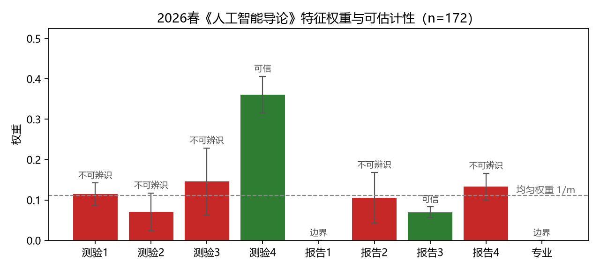
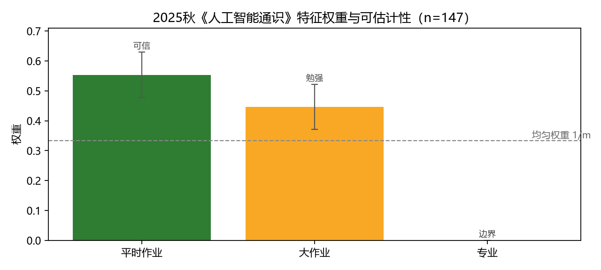

# 学情分型案例：HybridScope 在真实成绩数据上的应用

数据来自两个学期的《人工智能》类课程成绩表。**已脱敏**：姓名不落盘，学号经
SHA256 单向哈希取前 10 位；原始成绩文件不进入版本库。

## 建模设置

| 项 | 案例 A | 案例 B |
|---|---|---|
| 课程 | 人工智能导论（选修，100514T003） | 人工智能通识·信息类（必修，102000C001） |
| 学期 | 2026 春 | 2025 秋 |
| 样本 | 172 人（原始 173，剔除 1 名全零缺考） | 147 人 |
| 数值特征 | 阶段性测验 1–4、实验报告 1–4（共 8） | 平时作业、大作业（共 2） |
| 类别特征 | 专业（长尾合并为「其他」后 6 类） | 专业（4 类） |
| 分型标签 | 总评 <70 需关注 / 70–84 合格 / ≥85 优秀 | 同左 |

标签由总评成绩切分，构造特征时**只使用原始分项**，不使用加权后的过程成绩、
实验成绩与总评，避免标签泄漏。

## 一、去噪顾问：真实数据上判定「不要去噪」

| 案例 | 未去噪 CV 准确率 | 去噪后 CV 准确率 | Δ | 结论 |
|---|---|---|---|---|
| A | 0.8779 | 0.3837 | -0.4942 | 关闭 |
| B | 0.9524 | 0.4354 | -0.5170 | 关闭 |

两个案例中沿样本维的小波去噪都使交叉验证准确率**大幅下降**（案例 A 下降
49.4 个百分点）。这与论文关于「表格数据行序不构成平滑
信号」的结论一致：学生名册顺序是任意的，沿该方向做小波阈值去噪抹掉的是真实
的个体差异，而非测量噪声。产品据此自动关闭去噪，而不是默认开启。

## 二、案例 A：2026 春《人工智能导论》

分型质量：**ACC 0.9419　NMI 0.7720　ARI 0.8246**
（可分=False，Hessian 病态=False）



| 特征 | 权重 | 标准误 | z | 判定 | 达标所需样本 |
|---|---|---|---|---|---|
| 测验1 | 0.1144 | 0.0276 | +0.12 | 不可辨识 | 328 |
| 测验2 | 0.0709 | 0.0464 | -0.87 | 不可辨识 | 927 |
| 测验3 | 0.1456 | 0.0830 | +0.42 | 不可辨识 | 2961 |
| 测验4 | 0.3611 | 0.0452 | +5.53 | 可信 | 879 |
| 报告1 | 0.0000 | 0.0000 | +0.00 | 未启用(边界) | 不可达 |
| 报告2 | 0.1053 | 0.0628 | -0.09 | 不可辨识 | 1695 |
| 报告3 | 0.0699 | 0.0131 | -3.14 | 可信 | 75 |
| 报告4 | 0.1329 | 0.0331 | +0.66 | 不可辨识 | 471 |
| 专业 | 0.0000 | 0.0000 | +0.00 | 未启用(边界) | 不可达 |

**教学解读**

- **阶段性测验 4** 权重 0.361，
  显著高于均匀权重（z=+5.53），
  是可辨识的：这一次测验对区分学生水平贡献最大。
- **实验报告 3** 权重显著**低于**均匀权重（z=-3.14），
  方向为负且可辨识，说明该次报告区分度不足（评分过于集中），是教学改进的直接抓手。
- 其余 6 项（测验 1–3、报告 1/2/4）在当前样本量下**不可辨识**——不能据此断言
  它们不重要，只能说数据还不足以支撑结论。
- **专业**这一类别特征权重落在单纯形边界（0），说明专业背景不驱动成绩分型。

## 三、案例 B：2025 秋《人工智能通识》

分型质量：**ACC 0.9184　NMI 0.7164　ARI 0.7722**



| 特征 | 权重 | 标准误 | z | 判定 | 达标所需样本 |
|---|---|---|---|---|---|
| 平时作业 | 0.5537 | 0.0756 | +2.92 | 可信 | 2099 |
| 大作业 | 0.4463 | 0.0756 | +1.50 | 勉强 | 2099 |
| 专业 | 0.0000 | 0.0000 | +0.00 | 未启用(边界) | 不可达 |

平时作业权重 0.554
可辨识（z=+2.92），
大作业勉强（z=+1.50）。
特征维度降到 2 维后 Hessian 更病态（cond=1e+04），诊断置信度下降。

## 四、这个案例证明了什么

1. **方法可落地**：直接读入教务导出的 PDF/Excel 成绩表即可建模，无需手工整理。
2. **去噪结论在真实数据上成立**：论文关于「表格数据不该盲目去噪」的判断，在
   两份独立真实数据上都得到验证，且效应量很大。
3. **可估计性诊断有实际价值**：它把「哪些考核项真正区分学生」和「数据够不够」
   分开回答——前者给出改进教学的抓手，后者阻止过度解读。这是普通聚类工具给不了的。

## 复现

```bash
python cases/learning_analytics/parse_grades.py
python cases/learning_analytics/run_case.py
python cases/learning_analytics/make_report.py
```

## 五、统一字段口径后再谈跨学期漂移

前两节是两个学期**各自的**分项分析：春季 8 个考核项、秋季 2 个。这本来就不该
直接比——把「测验1」和「平时作业」当成同一个特征去算 Δw，得到的差异里混着
「字段拆得不一样」，而不是「教学变了」。

### 映射不是猜的，是数据验证出来的

把两学期的分项按语义折叠成两个 canonical 字段（过程考核 / 项目考核），再用
总评对这两个得分做最小二乘：

| 学期 | 拟合结果 | 残差 sd |
|---|---|---|
| 2025 秋 | 总评 ≈ 0.599 × 平时作业 + 0.401 × 大作业 | 0.295 |
| 2026 春 | 总评 ≈ 0.600 × mean(测验1–4) + 0.398 × mean(报告1–4) | 0.275 |

两学期对总评的加权结构都是 **60 / 40**，说明「平时作业 ↔ 测验1–4」「大作业 ↔
报告1–4」确实是同一对构念，映射成立。

### 「专业」这一列不能比

春季「专业」填的是专业名（选修课，学生来自计算机、电子、机器人等），秋季那
一列填的是行政班（计算机 25-1 班、留学生班……）。两列取值域重合度 **0.00**，
同名不同义，映射里标为不可比。春季它是权重最大的一项（0.64），秋季权重为 0
（同一个专业的四个班没有区分力）——如果把它放进跨学期对比，它从 0 变到 0.64
必然从其余列身上挤走份额，Δw 就讲不清了。所以跨学期对比**只用可比字段**跑。

### 统一口径下的结果

| 学期 | 过程考核 | 项目考核 | 校正后结论 |
|---|---|---|---|
| 2025 秋 | 0.5620（se 0.0526，z=+1.18） | 0.4380（z=−1.18） | 都不显著，q=0.239 |
| 2026 春 | 0.3721（se 0.0230，z=−5.55） | 0.6279（z=+5.55） | 都显著，q=2.8e−08 |

跨学期对比（Δw / 标准误）：过程考核 **0.562 → 0.372**，项目考核
**0.438 → 0.628**，z = ∓3.31，q = 0.001，整体卡方 21.87（df=1，p<0.001）——**真漂移**。

数据侧自洽：项目考核均值 66.94 → 76.71（SMD = +0.57，判为漂移），过程考核几乎
没动（SMD = −0.01）。春季项目类考核（实验报告）的给分明显更高，它在分型里的
权重也相应上升。

这一节还给出一个方法论上的提醒：**单看一个学期，秋季「过程 vs 项目」是区分
不开的**（q=0.239，样本不够）；但两个学期合起来看，权重分配确实变了
（q=0.001）。单批次精度不足，不等于批次之间没有差异——这正是对比的价值。

### 复现

```bash
python cases/learning_analytics/make_unified.py     # 对齐 + 审计 + 写长表
python cases/learning_analytics/run_case.py         # 含统一口径层与跨学期对比
```

产物：`data/grades_unified.csv`（319 行长表）、`schema_grades.json`（映射存档）、
`snap_unified_*.json`、`report_unified_*.html`、`run_v3.log`。
